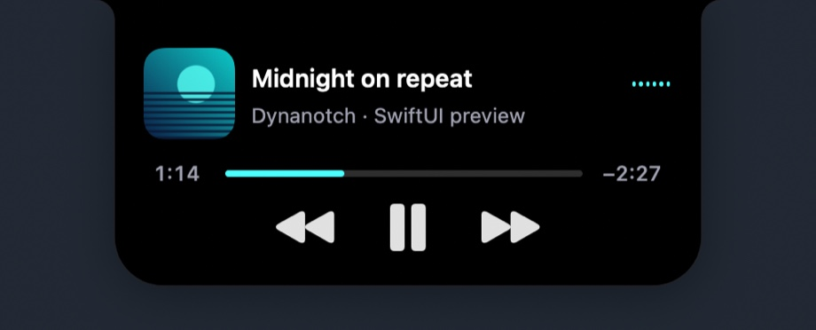
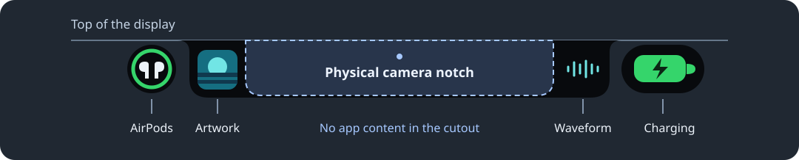
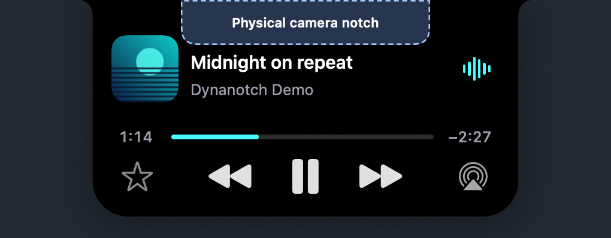

# Dynanotch

**Version 1.0.3**

A SwiftUI and AppKit app that turns the MacBook camera notch into an interactive spot for media, device battery information, and system controls. Dynanotch draws its own interface. It runs without patches to macOS or changes to SIP.



## See it in action

The demo shows the notch expanding and collapsing, the cover flipping at about 0:02, play and pause transitions, and the AirPods bubble opening to show battery details. [Watch the 60 fps MP4](docs/images/dynanotch-motion.mp4).


**AirPods connected while music is playing.** The connection bubble appears on the left, music stays in the center, and the MacBook’s charging pill sits on the right.


**Click the AirPods bubble for battery details.** The bubble grows into a pill with separate case, left, and right readings. AirPods Max shows a single reading.


These screenshots are rendered by Dynanotch using sample media and battery readings.

**Where the physical notch sits.** The dashed outline marks the camera cutout on a notched MacBook. Artwork and the waveform stay on either side, with AirPods and charging in separate bubbles farther out.



**Expanded player.** The dashed overlay shows the same physical cutout above the title. The player grows down from the screen edge, with playback controls below the cutout.



## What it does

- **Now playing.** Expand the notch to see artwork, scrolling track information, a seek bar, and playback controls for Music and Spotify. Music also supports favorites and AirPlay output selection. Track changes flip the cover in place, and the waveform and progress bar take their accent from the artwork.
- **Audio from other apps.** Browser and other supported app audio can show an app icon and live waveform. Dynanotch does not read individual browser tabs for track metadata or playback controls.
- **AirPods.** Connection notices show the reported listening battery level and play one rotation of the pairing animation before dismissing. Click the left AirPods satellite to keep the pill open and see separate case, left, and right readings. Headphones such as AirPods Max show a single reading. Missing readings stay unavailable.
- **Charging and volume.** Charging and volume can use their own trailing pill when the main notch is occupied. Volume changes during playback keep the artwork visible; an × marks mute.

## Download

Download the precompiled Apple Silicon ZIP from the [latest release](https://github.com/Eduannnn/Dynanotch/releases/latest). The app is ad hoc signed and unnotarized. The ZIP includes a README with commands for signing your copy using your own Apple Development certificate. You can also build and sign it from source below.

### macOS compatibility

| Version | Status |
| --- | --- |
| **macOS 27.3 beta (26C5035r)** | **Supported and tested** on an M2 MacBook Air. All 20 sampled AirPods artwork cases decoded, and the native skip animations loaded and played. |
| macOS 27.2 | Unverified. AirPods movies and native skip animations need to be checked on that build before claiming support. |
| Other macOS versions | Not verified for this release. The deployment target is macOS 14.4; Liquid Glass requires macOS 26 or later. |

The app reads optional artwork and animations from the installed macOS. Missing resources fall back to SF Symbols.

## Build from source

Use Xcode with Swift 6 and an Apple Development or Developer ID Application signing identity in Keychain. For an Apple Development identity, open Xcode → Settings → Accounts → Manage Certificates. Get the source ZIP from the release, or clone the repository:

```sh
git clone https://github.com/Eduannnn/Dynanotch.git
cd Dynanotch
```

### Option 1: Build in Terminal

```sh
./Scripts/build-app.sh
open Build/Dynanotch.app
```

The script builds a release app and verifies its signature. If you have several valid certificates, select one using `DYNANOTCH_SIGNING_IDENTITY` or the ignored `.signing-identity` file. Both take the certificate fingerprint.

### Option 2: Build in Xcode

1. Add your team and certificate fingerprint to the ignored `Signing.local.xcconfig` file, as shown in [stable signing](docs/stable-signing.md).
2. Open `Dynanotch.xcodeproj` and select the **Dynanotch-macOS** scheme and **My Mac**.
3. Choose **Product → Run**. To build without launching, choose **Product → Build** and find the app in Xcode’s Products group.

For everyday use, keep a single copy in Applications. Quit the running app before replacing it. Keep its bundle identifier and signing identity stable between updates to help macOS retain permission grants.

## Use the notch

- Hover over an active compact notch to expand it temporarily. Click to pin it open; press Escape or click outside to collapse.
- Open Settings from the menu-bar icon or by reopening Dynanotch from Applications. With Accessibility enabled, press **⌘,** while the pointer is over the notch.
- In General settings, preview AirPods notices by model, choose a Max color, and simulate missing battery information. Preview readings are sample values and do not connect a device.

| macOS permission | Used for |
| --- | --- |
| Automation | Reading and controlling Music or Spotify when you use that player |
| System audio recording | Measuring live audio for the waveform; no microphone input or recordings written to disk |
| Accessibility | The notch Settings shortcut and optional replacement for the volume and brightness overlays |

Quit Dynanotch before removing or re-granting Accessibility. See the [input incident notes](docs/incident-2026-11-10.md) for the confirmed findings and remaining uncertainty.

## Development

```sh
xcrun swift test
./Scripts/build-app.sh
Build/Dynanotch.app/Contents/MacOS/Dynanotch --verify-app Build/Verification
```

`NotchCore` holds the shared activity, input, and audio logic. `NotchMac` handles windows, SwiftUI, and macOS integrations. The app verifier uses synthetic activities and battery readings. Live Bluetooth readings, lock-screen visibility, and routing audio to a physical AirPlay receiver still need broader hardware testing. Optional system adapters vary by macOS release. Apple pairing movies and skip animations are read from the installed OS when available; they are not distributed here.

See the [changelog](CHANGELOG.md), [porting notes](PORTING.md), and [implementation notes](docs/). Dynanotch began as a Swift port of [Eduannnn/quickshell-notch](https://github.com/Eduannnn/quickshell-notch) at commit `85505dcd789589a61cc981115b892d6475e11ada`.

## License

Dynanotch is licensed under the [GNU General Public License v3.0](LICENSE).
