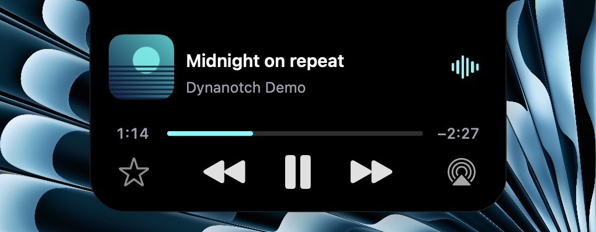
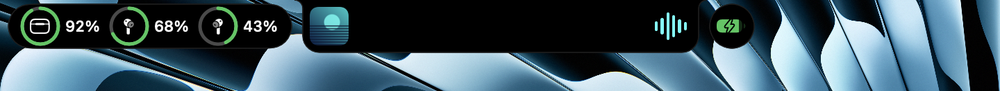
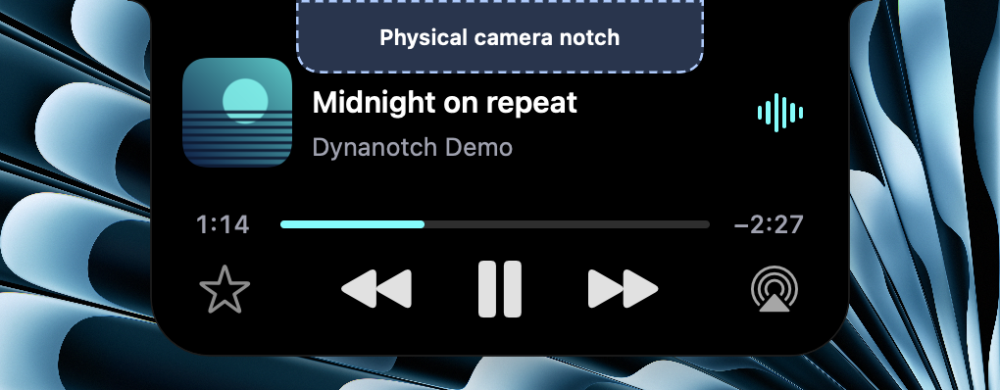

# Dynanotch

**Version 1.2.0 · Tested on macOS 27.3 beta**

A SwiftUI and AppKit app that turns the MacBook camera notch into an interactive spot for media, device battery information, and system controls. Dynanotch draws its own interface. It runs without patches to macOS or changes to SIP.

Dynanotch brings a bit of the newer MacBooks’ Dynamic Island to your notch. On macOS 27.3 beta, it loads Apple’s AirPods connection animations and native playback skip animations directly from the system resources installed on your Mac.



## Download

Download the precompiled Apple Silicon ZIP from the [latest release](https://github.com/Eduannnn/Dynanotch/releases/latest). The app is ad hoc signed and unnotarized. The ZIP includes a README with commands for signing your copy using your own Apple Development certificate. You can also build and sign it from source below.

### Universal 2 and themes

The v1.2.0 download includes **arm64 and x86_64 in one app**. Choose the Universal 2 ZIP for Apple Silicon or Intel. The precompiled app is ad-hoc signed; local signing instructions are included in the ZIP.

JSON themes live in `~/Library/Application Support/Dynanotch/Themes`. Open them through **Settings → JSON themes → Open theme files**. `global.json` supplies shared defaults; collapsed, expanded, notice, AirPods, charging, OSD, browser, locked, and unlocking files override individual states. `REFERENCE.json` explains the element, layout, typography, glass, symbol, waveform, and animation controls. Changes reload automatically; malformed files retain the last working theme. Default templates are in `Resources/Themes`.

The player opens on click. Hovering produces a small swell. Optional expanded Liquid Glass uses native compositor refraction and a black camera fade; the collapsed notch stays black. The refraction renderer uses private macOS APIs, so its availability can change between macOS releases.

### macOS compatibility

| Version | Status |
| --- | --- |
| **macOS 27.3 beta (26C5035r)** | **Supported and tested** on an M2 MacBook Air. All 20 sampled AirPods artwork cases decoded, and the native skip animations loaded and played. |
| macOS 27.2 | Unverified. AirPods movies and native skip animations need to be checked on that build before claiming support. |
| macOS 13 Ventura–15 Sequoia | Experimental. Universal 2 binaries target macOS 13.0; runtime testing on these versions is still needed. Older systems use compatible animation and black-surface fallbacks. |
| macOS 26 and newer | Liquid Glass can be enabled where supported. Full hardware testing beyond the listed tested system is still needed. |

The app reads optional artwork and animations from the installed macOS. Missing resources fall back to SF Symbols. AirPods movies and native skip resources are not bundled in this public download. Live audio waveform capture requires macOS 14.4 or newer; it is unavailable on Ventura. Ventura uses a timer only while a surface transition is active, and simpler symbol/favourite animations.

## Now playing

Expand the notch to see album artwork, scrolling track information, a seek bar, and playback controls for Music and Spotify. Apple Music also supports favorites and AirPlay output selection. Track changes flip the cover in place, and the waveform and progress bar take their accent from the artwork.

Browser and other supported app audio can show an app icon and live waveform. Dynanotch does not read individual browser tabs for track metadata or playback controls.

## AirPods, charging, and volume

AirPods connection notices show the reported listening battery level and play one rotation of the pairing animation before dismissing. When AirPods connect while music is playing and the Mac is charging, AirPods appear on the left, music stays in the center, and charging sits on the right.


Click the AirPods bubble to keep the pill open and see separate case, left, and right readings. AirPods Max shows a single reading. Missing readings stay unavailable.



Charging and volume can use their own trailing pill when the main notch is occupied. Volume changes during playback keep the artwork visible, and an × marks mute.

## How it fits around the camera

The dashed outlines mark the physical camera cutout. In compact mode, artwork and the waveform sit on either side. The expanded player grows down from the screen edge, with controls below the cutout.

| Compact | Expanded |
| --- | --- |
|  |  |

The screenshots and demo use sample media, waveform levels, and battery readings.

## Use the notch

- Hover over an active compact notch to expand it temporarily. Click to pin it open; press Escape or click outside to collapse.
- Open Settings from the menu-bar icon or by reopening Dynanotch from Applications. With Accessibility enabled, press **⌘,** while the pointer is over the notch.
- In General settings, preview AirPods notices by model, choose a Max color, and simulate missing battery information. Preview readings are sample values and do not connect a device.


### Permissions

| macOS permission | Used for |
| --- | --- |
| Automation | Reading and controlling Music or Spotify when you use that player |
| System audio recording | Measuring live audio for the waveform; no microphone input or recordings written to disk |
| Accessibility | The notch Settings shortcut and optional replacement for the volume and brightness overlays |

Quit Dynanotch before removing or re-granting Accessibility. See the [input incident notes](docs/incident-2026-11-10.md) for the confirmed findings and remaining uncertainty.

## Build from source

Use Xcode with Swift 6 and an Apple Development or Developer ID Application signing identity in Keychain. For an Apple Development identity, open Xcode → Settings → Accounts → Manage Certificates. Get the source ZIP from the release, or clone the repository:

```sh
git clone https://github.com/Eduannnn/Dynanotch.git
cd Dynanotch
```

### Option 1: Build in Terminal

```sh
./Scripts/build-app.sh
open Build/Dynanotch.app
```

The script builds a release app and verifies its signature. If you have several valid certificates, select one using `DYNANOTCH_SIGNING_IDENTITY` or the ignored `.signing-identity` file. Both take the certificate fingerprint.

### Option 2: Build in Xcode

1. Add your team and certificate fingerprint to the ignored `Signing.local.xcconfig` file, as shown in [stable signing](docs/stable-signing.md).
2. Open `Dynanotch.xcodeproj` and select the **Dynanotch-macOS** scheme and **My Mac**.
3. Choose **Product → Run**. To build without launching, choose **Product → Build** and find the app in Xcode’s Products group.

For everyday use, keep a single copy in Applications. Quit the running app before replacing it. Keep its bundle identifier and signing identity stable between updates to help macOS retain permission grants.

## Development

```sh
xcrun swift test
./Scripts/build-app.sh
Build/Dynanotch.app/Contents/MacOS/Dynanotch --verify-app Build/Verification
```

`NotchCore` holds the shared activity, input, and audio logic. `NotchMac` handles windows, SwiftUI, and macOS integrations. The app verifier uses synthetic activities and battery readings. Live Bluetooth readings, lock-screen visibility, and routing audio to a physical AirPlay receiver still need broader hardware testing. Optional system adapters vary by macOS release. Apple pairing movies and skip animations are read from the installed OS when available; they are not distributed here.

See the [changelog](CHANGELOG.md), [porting notes](PORTING.md), and [implementation notes](docs/). Dynanotch began as a Swift port of [Eduannnn/quickshell-notch](https://github.com/Eduannnn/quickshell-notch) at commit `85505dcd789589a61cc981115b892d6475e11ada`.

## License

Dynanotch is licensed under the [GNU General Public License v3.0](LICENSE).
