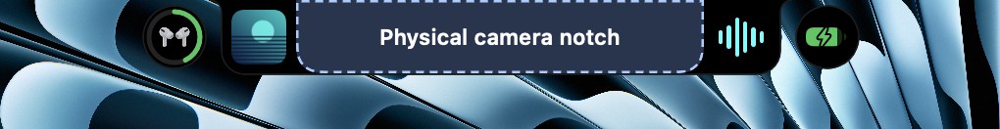
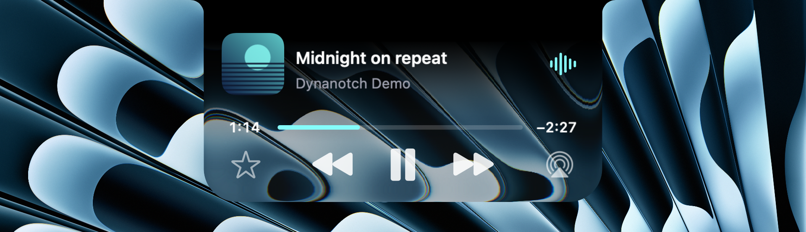

# Dynanotch

Dynanotch gives your MacBook notch something to do. Click it to see what’s playing, check your AirPods battery, or glance at your volume and brightness.


## Get Dynanotch

Download the **Apple Silicon (ARM64)** ZIP from [GitHub Releases](https://github.com/Eduannnn/Dynanotch/releases/latest), unzip it, and move Dynanotch to Applications. The download is ad hoc signed. If macOS asks you to allow it, open **System Settings → Privacy & Security**. The ZIP also has instructions for signing it with your own Apple Development certificate.

I test Dynanotch on an M2 MacBook Air running **macOS 27.3 beta**. The app targets macOS 14.0, with live waveforms from 14.4 and optional Liquid Glass from macOS 26. Older versions still need more testing. Dynanotch can load the newer MacBooks’ AirPods and skip animations from macOS 27.3 beta. The download also bundles those animations and falls back to symbols when needed.

## Using the notch

Click to open the player. Click its top edge or anywhere outside to close it. You can skip, pause, or scrub in Music and Spotify, and favorite tracks or pick an AirPlay output in Apple Music. Browser audio can show the app icon and a live waveform.

Volume and brightness briefly take over the main notch. The icon sits on the left, the bar sits below the camera cutout, and the percentage sits on the right. Automatic brightness changes stay quiet.

## AirPods and charging

Connect your AirPods to see the pairing animation and a battery ring. Click their bubble to see the case and each earbud’s charge. AirPods Max shows a single reading. When you plug in your Mac, the charging level briefly takes over the main notch, including on the lock screen.


## How it fits

The dashed outline shows where the physical camera notch sits. On displays without a notch, Dynanotch uses a smaller floating pill that shrinks away when idle.

| Compact | Expanded |
| --- | --- |
|  |  |

Turn on **Liquid Glass** in Settings to see the wallpaper bend through the expanded player.



## In motion


The demo uses sample tracks and battery readings.

## Settings and permissions

Open Settings from the menu-bar icon or press **⌘,** while pointing at the notch. Pick an AirPods model to try a preview. Use **Advanced → More settings (Dangerous!) → Open theme files** to change the layout, colors, and motion. Edits reload when you save. Use the optional `design` group in `global.json` to share padding, spacing, and radii across views. `REFERENCE.json` lists the keys and explains how they work with existing themes.

| Permission | Why Dynanotch asks |
| --- | --- |
| Automation | To read and control Music or Spotify |
| System audio recording | To draw the waveform from live audio without saving recordings or using the mic |
| Accessibility | To open Settings with the shortcut and optionally show volume and brightness in the notch |

Quit Dynanotch before changing its Accessibility permission. [Input incident notes](docs/incident-2026-11-10.md)

## Build from source

Install Xcode with Swift 6 and add an Apple Development or Developer ID Application certificate to Keychain.

```sh
git clone https://github.com/Eduannnn/Dynanotch.git
cd Dynanotch
./Scripts/build-app.sh
open Build/Dynanotch.app
```

The script builds for your Mac’s architecture. If you have multiple signing identities, put the certificate fingerprint in `DYNANOTCH_SIGNING_IDENTITY` or the ignored `.signing-identity` file. To use Xcode, open `Dynanotch.xcodeproj`, set up `Signing.local.xcconfig`, and run **Dynanotch-macOS** on **My Mac**. [Signing instructions](docs/stable-signing.md)

For development, run `xcrun swift test` or launch the built executable with `--verify-app Build/Verification` to check the notch with sample activities. Dynanotch started as a Swift port of [quickshell-notch](https://github.com/Eduannnn/quickshell-notch).

[Changelog](CHANGELOG.md) · [Porting notes](PORTING.md) · [GPL-3.0 license](LICENSE)
